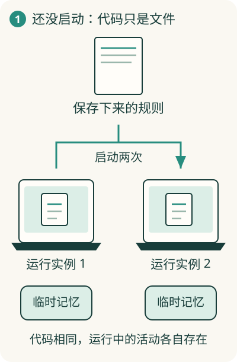

# 代码放在那里，为什么软件还没开始工作？

一份菜谱放在桌上，饭不会自己出现。同样，写好的代码放在文件里，也不会自动回应你的点击。**运行，就是让电脑开始执行代码里描述的工作。**

菜谱只用来说明“说明书和实际做事不同”。电脑执行的是明确的指令，没有厨师那样的生活理解能力。

## 文件是静止的，运行会占用电脑

假设阅读助手的代码已经写好。启动以前，代码是一批保存着的文件。启动以后，电脑开始处理点击、读取文章，还要暂存当前打开的内容。

这份正在进行的程序活动，会占用电脑的计算和记忆空间。操作系统把这样的运行实例叫作**进程**。操作系统就是电脑上负责安排各个程序使用机器的基础软件，例如 Windows 或 macOS。

图中两扇窗口代表两个运行实例，不表示每个真实窗口都恰好对应一个进程。你需要先看懂的是：**一份代码，可以产生多份正在工作的实例。**

## 谁把代码里的话变成机器动作？

机器最终执行自己的指令。人写的编程语言，需要相应的软件来执行或转换。不同语言的过程有所不同：有些先转换成机器能执行的形式，有些交给语言执行器处理。

执行代码时所需的这套支持，常被称为**运行时**。例如浏览器带有执行 JavaScript 的能力，所以网页中的这类代码能在浏览器里工作。你不必先学 JavaScript，先理解“代码需要与它匹配的执行能力”。

运行时和操作系统各管一层：前者支持特定语言的执行，后者安排程序使用电脑。仅有操作系统，未必已经有某种代码需要的全部支持。

## 从双击图标到能回应你，中间发生什么？

以本机阅读助手为教学示例，先忽略不同系统的具体启动细节：

1. 你点图标，操作系统找到启动入口，开始安排这份程序活动使用内存和处理时间。
2. 执行代码所需的支持被准备好。网页中的 JavaScript 由浏览器提供执行支持，其他程序可能使用随软件一起提供的运行时，或直接执行提前转换好的机器指令。
3. 程序做启动工作，例如读设置、准备文章列表，建立等待用户操作的入口。
4. 你点文章标题，程序处理这个动作，再把结果交给界面显示。

如果第2步缺少所需执行能力，程序可能根本启动不了；如果第3步找不到文章文件，窗口可能已经出现，正文却还不能读。“进程存在”“页面出现”“功能可用”是逐步成立的不同结果。

程序也可能启动后一直等待请求，暂时不做新的计算。处于运行中，不表示它每一瞬间都在忙碌；操作系统可以先把处理时间交给别的程序。

## 为什么换一台电脑，程序可能跑不起来？

代码可能还需要别的现成软件，比如读取 PDF 的组件。它用到了对方的能力，就对对方形成了**依赖**。新电脑如果没准备这些组件，即使代码一样，也可能无法完成工作。

因此“软件能运行”要同时具备：要执行的代码、合适的执行支持，以及它需要的其他能力。这些条件合在一起，可以叫运行环境。

例如两台电脑都有同一份代码，但其中一台缺少读取 PDF 的组件，打开普通文字可能成功，打开 PDF 才失败。因此环境问题既可能在启动时暴露，也可能等到某项能力被使用时才暴露。

让 AI 交付软件时，可以要求它说明：启动入口是什么、需要准备哪些执行支持和组件、用什么可见结果确认已能工作。换电脑时逐项准备这些条件，比只复制一份文件更接近“把同一个软件运行起来”。

关闭软件会结束一些运行中的活动和临时记忆，已经保存到文件里的内容则可以继续留下。理解这个区别，接着读[计算、内存和存储](03-resources.md)，就容易知道机器各部分在做什么。
