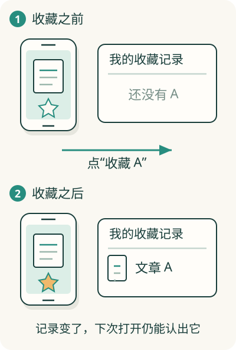

# 为什么软件能记得你刚才做过什么？

你把同一篇文章打开两次。第一次它没有收藏标记；点过收藏以后，第二次打开，星星已经亮了。文章没变，你的动作也一样，软件的反应却变了。

原因是系统留下了“你收藏过这篇文章”的信息。**那些留在系统里、会影响接下来行为的信息，就是状态。**

## 先看一个动作前后的区别

在这个假设的阅读助手里，点击以前，你的收藏清单里没有文章 A。点击以后，清单里有了文章 A。页面再查这份清单，就知道应该把星星点亮。

亮星星是显示给你的结果。背后的记录解释了为什么下次还能显示同样的结果。有些产品会先亮星星，再等待保存成功；这时亮了也可能还没真正保存。**屏幕上的样子和背后的记录，需要配合。**

## 星星先亮，后来却灭了，是怎么回事？

有的产品为了及时回应，会先把页面里的“已收藏”改为真，显示亮星星，同时把保存要求送出去。这叫先在界面预示一个预计成功的结果，而不是已经证明记录写好了。

接下来需要接住两种结果：服务端确认保存，页面保留亮星星；服务端明确拒绝，页面恢复空星星并说明原因。如果只是一直收不到回复，不能立刻断定保存失败，还要重新查询或让用户重试确认，详见[失败](../05-reliability/17-failure.md)。

所以同一时刻可能有“页面预计的状态”和“已经保存的状态”。程序要安排它们如何重新对上。也可以采用更保守的界面：先显示“收藏中”，等确认后再点亮。两种选择改变的是等待体验与恢复工作，并没有省掉保存本身。

## 软件的记忆有长有短

你还可能展开目录、输入一半搜索词、选中一篇文章。软件也要记住这些信息，才能继续当前操作。它们同样是状态，但不一定值得永久保存。

想象一张工作桌：手边便签帮助你处理眼前的事，归档的记录留到下次使用。软件中也有这类区别：有些信息只留在运行中的临时记忆里，有些写到可以长期保留的文件或数据库里。数据库是帮助程序组织、查找、修改记录的软件。

这只是寿命的类比。临时和长期信息都可能在你的设备上，也都可能在远处的电脑上；不能只凭“前端”或“后端”判断是否会丢。

## 一份事实，可以带出几种显示

如果清单里有三篇收藏，页面可以显示“收藏 3 篇”。这个数字能由清单数出来。程序员会叫它**派生状态**：从已有信息算出的信息。

于是这里有三种不同东西：收藏清单是记录；“3 篇”是从记录算出的结果；当前展开哪个目录是界面临时记住的选择。分清它们，才容易说明哪份东西改变时，什么显示要跟着改变。

## 收藏数量为什么也会算错？

假设清单原有三篇，加入 A 后已有四篇；页角却仍显示“3篇”。保存记录未必有错，可能只是页面没有重新计算。若又把数量独立保存，加入和删除还要同时维护两个地方，漏改一次就会不一致。

能直接从清单算出的数量，可以尽量从清单取得；确实为了速度预先保存计数，也要规定谁更新、何时校正。这个判断也适用于购物车金额和未读消息数：先找决定事实的记录，再找由它算出的显示。

## 从“能记住”走到“记在哪里”

只在你的手机保存收藏，另一台电脑通常看不到它。希望跨设备使用，就需要一份两边都能访问的记录，或者安排两边交换更新。

这自然引出[存储](07-storage.md)和[一致性](08-consistency.md)：前者解释怎么留住和找出信息，后者解释多份信息怎样对上。你现在先抓住一个判断：**软件会因为已经记住的事情，而对下一次输入作出不同反应。**
