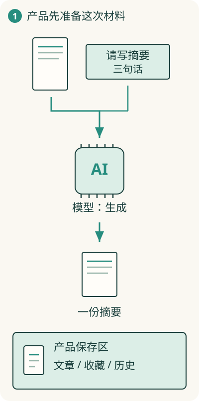

# AI 在软件里负责什么，其他部分还用来做什么？

阅读助手能保存文章，也能生成摘要。保存一份记录可以按明确规则做；把长文章概括成几句话，则需要理解和生成文字的能力。

**AI 模型可以作为软件中的一项能力，负责理解、生成或选择；整个产品还需要其他部分组织这项能力。**

## 模型吃进材料，给出输出

假设软件把文章正文和“写三句话摘要”的要求交给模型。模型根据这些输入，生成一段文字。使用训练好的模型处理输入、产生输出，这个过程叫**推理**。

模型这次实际得到的要求、正文、对话等材料，叫**上下文**。如果文章根本没被送进去，模型就不能据此准确概括那篇文章，可能只能根据已有输入和训练中形成的能力猜测。

## 把一次摘要的材料和结果摆出来

下面的短文和输出都是为讲解编写的示意，并不是一次真实模型测试：

> 原文：周六上午在城北公园徒步，路线约两小时。下午可能下雨。集合时间尚未确定。
>
> 要求：概括活动安排，保留不确定信息，不补充原文没有的时间。

软件先取得这份正文，再与要求一起交给模型。假设返回“周六上午城北徒步约两小时，下午可能下雨，集合时间待定”，就能逐项对照材料。

如果候选摘要写成“周六9点集合”，即使读起来顺畅，也增加了原文没有的事实。产品需要按任务检查，并可能请人核对或重新生成；把同一段话保存到数据库，不会使它因此变真。

这里的原理是：**模型依据这次实际得到的材料生成候选结果，软件还要负责材料是否齐全、结果是否适合使用**。如果只提供文章标题，或者长文只取了前半段，就不能把输出当成读过全文的证明。

## 三种“记忆”先分开看

训练使模型形成了处理语言和信息的能力，但不等于它记住了你产品数据库里的每条私人记录。这次提供的上下文让它接触具体材料；产品里的数据库则保留文章、收藏和历史结果。

所以一个聊天产品“下次还记得你说过什么”，可能是产品保存了对话，下次重新提供给模型。不能直接推断模型自身永久记住了这些话。

## 材料太多时，先找到相关的

如果收藏有上万篇，通常不必每次都把全文全部送给模型。软件可以先查出与问题相关的文章，再提供给模型。这一步叫**检索**。

把检索所得材料交给模型辅助生成，常见名称是 RAG。它让模型有机会依据指定资料回答，但资料没找对、理解错误或输出编造仍可能发生。提供来源不自动保证答案正确。

## 检索怎样把“我的资料”接进来？

假设你问“我收藏的旅行文章里，哪些提到下雨”。一种流程是：先按当前账号和权限查收藏，在能访问的文章里找相关段落，保留对应文章编号，再把问题和这些段落一起提供给模型。

模型看到资料以后，可以组织答案；软件再把文章入口与回答一起显示，让你回看原文。来源入口应由软件绑定到真正取出的记录，不能只让模型随手编一个看起来合理的网址。

如果检索没找出相关段落，模型这次就缺少依据。产品可以明确说明“没有在这次找到的材料中发现”，而不能据此断言全部收藏都没有。找到了包含“雨”的段落，也不代表一定相关，还要看它在说旅行天气还是别的事。

换成个人账单或公司制度，同样需要先处理访问范围、取出材料、提供上下文和核对结果。RAG改变的是模型获得本次资料的路径，并不会自动保证每次都找全、理解对、回答准。

## 一次模型回答，还不是完整的产品动作

生成摘要后，软件仍要决定把结果显示在哪里、是否保存、谁能看、失败时怎么办。重要输出也需要适合任务的检查，不能仅因文字流畅就当成事实。

因此 AI 软件仍然需要程序、状态、接口、权限与验证。模型在地图中增加一种能力；如果还让模型决定下一步去做什么，就进入[Agent](25-agent.md)的结构。
