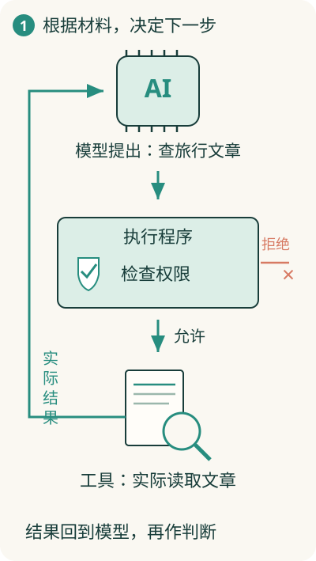

# 聊天 AI 怎样变成能替你做事的助手？

你说“找出我收藏里与旅行有关的文章，整理一份摘要”。普通回答可能直接给出建议；能做事的助手需要查收藏、取得文章、读结果，再决定下一步。

**Agent 可以先理解成：让模型参与决定后续行动，并根据执行结果继续工作的系统**。它需要模型之外的执行能力。

## 从建议到行动，中间还要有人执行

模型可以提出“查询旅行文章”。真正查询数据库的，是软件提供的查询能力。供助手调用的具体能力，常叫**工具**，例如查找文章、读取正文。

把模型、工具、权限和运行过程组织起来的程序，可以叫**宿主**。模型输出一个行动要求，宿主检查并调用工具，再把结果给模型看。仅输出“已删除文章”，不等于真的执行了删除。

## 反馈让下一步可以改变

第一次查询找到20篇，模型可能只读其中几篇；如果没找到，它可能换搜索词。它根据新结果调整行动，而不是只在开头生成一段长计划。

这个循环需要明确什么时候停止：已经完成、没有可用资料、遇到错误，或者达到步数和资源限制。否则系统可能一直查下去，却没有更有用的结果。

## 跟完一次“找文章，再整理”的循环

以下是虚构且预设的过程，用来展示交接，不代表真实模型一定选择这些步骤：

1. 你要求“从我的收藏找雨天旅行建议”。软件把目标、允许使用的查询工具和停止限制交给模型。
2. 模型提出搜索“旅行 下雨”。宿主核对当前账号和工具权限，真正调用查询，得到三条编号和简介：A17徒步天气、A28雨天室内去处、A31另一个无关话题。
3. 查询结果作为新材料交回模型。模型根据简介选择读A17和A28，提出读取要求；宿主再次核对各篇可访问，再取得正文。
4. 若A28已删除，工具返回“不可用”。模型收到的就是这份失败结果，应继续依据A17作有限回答、换一篇查找，或说明资料不足，不能把没读到的内容写成已确认事实。
5. 得到可用正文后，模型组织答案。软件把实际读取过的文章入口与结果交给你，并结束这次工作。

每一轮都有“提出行动、检查、执行、返回新材料”，后一个判断依赖前一轮实际结果。列一份五步计划却没有调用任何工具，和这条循环并不相同。

如果查询始终找不到，或已经达到允许的步数、时间或花费范围，宿主也要能让循环停止。不能只靠模型一开始答应“我会适可而止”。

## 固定工作流和 Agent 怎样区分？

如果顺序事先规定为“收到文章→生成摘要→保存”，路径主要由软件预先安排，通常称为**工作流**。

如果某些后续步骤由模型根据结果动态选择，就更接近 Agent。真实产品可以组合两者：外层保持固定审核流程，里面允许模型选择查询方式。自主程度有高有低，并非每个 AI 产品都需要同样自由度。

## 能做事，也要知道哪些事不能做

读文章和删除全部收藏，是不同权限。工具范围、访问身份和重要动作的确认，应由系统落实。模型的判断不能替代执行位置的[权限检查](../05-reliability/18-trust.md)。

假如目标改成“删除所有无关文章”，一次判断错误的代价就更高。可以先只生成拟删除清单和理由，让你检查后再执行，并由执行程序核对确认是否对应同一清单。只在聊天里说一句“需要谨慎”，没有改变工具的权限或执行条件。

设计助手时，可以让 AI 展示一轮真实交接的格式：它能提出什么行动，程序怎样判断允许，工具会回哪些结果，什么时候交还给人。把这一轮说明白，再决定允许重复多少轮、开放哪些动作。

Agent 把决定、执行和反馈连接成循环；它依然有[状态](../02-state/06-state.md)、[等待](../03-communication/12-time.md)、失败和成本。这也是为什么“接一个模型”与“做一个可靠助手”之间，还有许多普通软件工作。
